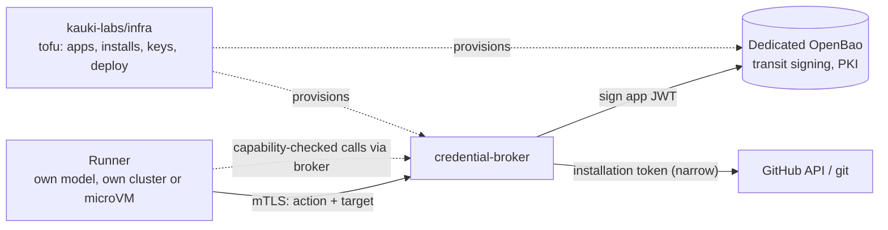

# credential-broker

A network service that issues short-lived, action-scoped credentials (GitHub, an LLM API, later
others) to external runners (agents running their own models). It holds the long-lived keys in a
dedicated OpenBao. A runner proves its identity, asks for one action on one target, and gets the
credential in the mode that fits: A, a proxied call; B, a leased copy the broker revokes and
rotates; C, an OIDC identity token. The broker hosts no LLM.

Status: design only. No code, no deployment, no GitHub App registered yet. The design package is
in [`design/credential-broker/`](design/credential-broker/README.md). No deep spec at `docs/spec.md`:
the design package carries it until the design settles.

## Context

## Layout

| Path | Holds |
|------|-------|
| `docs/decisions/` | active decisions and the alternatives set aside |
| `docs/design/credential-broker/` | design package: proposal, decision log, spec |
| `scripts/validate_docs.py` | docs structure check, run by CI |
| `.github/` | CI, templates, CODEOWNERS, Dependabot |

## Related

- GitHub App registration, installs, OpenBao and deployment: `kauki-labs/infra`
  (`tf/cloud/02-github`).
- The sandbox credential seam this complements: `kauki-labs/sandy`,
  `docs/decisions/credential-seam.md`.
