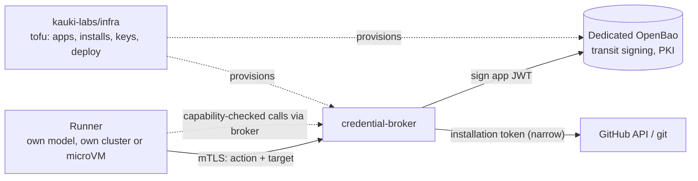

# credential-broker

A network service that issues short-lived, action-scoped GitHub credentials to external
runners (agents running their own models). It holds the GitHub App private keys. A runner
proves its identity, asks for one action on one target, and gets back a narrow capability.
The broker keeps the real GitHub token and forwards the runner's calls. The broker hosts no
LLM and holds no model key.

Status: design only. No code, no deployment, no GitHub App registered yet.
No deep spec yet: `docs/spec.md` waits until the design settles.

## Context

## Layout

| Path | Holds |
|------|-------|
| `docs/decisions/` | active decisions and the alternatives set aside |
| `scripts/validate_docs.py` | docs structure check, run by CI |
| `scripts/github-app-token` | interim operator-side minter for the `external` GitHub App ([runbook](runbooks/external-app.md)) |
| `apps/` | GitHub App manifests |
| `tests/` | offline acceptance tests (CI) and live acceptance tests (operator only) |
| `.github/` | CI, templates, CODEOWNERS, Dependabot |

## Related

- GitHub App registration, installs, OpenBao and deployment: `kauki-labs/infra`
  (`tf/cloud/02-github`).
- The sandbox credential seam this complements: `kauki-labs/sandy`,
  `docs/decisions/credential-seam.md`.
